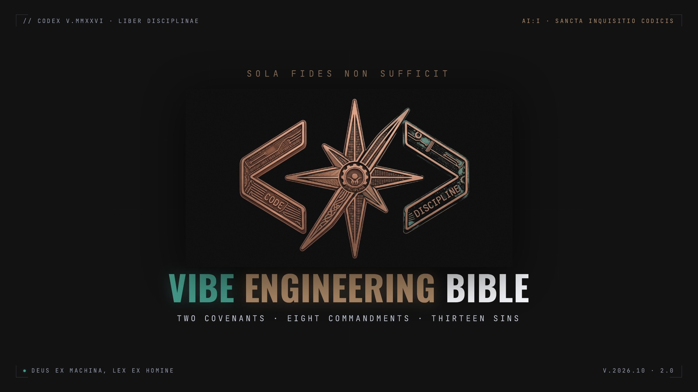

# Vibe Engineering Bible



Rules and working playbooks for developers and maintainers using AI assistants. Start with a repository audit: findings tied to evidence, Bible requirements, and minimal fixes. A human decides what to change.

The main product is Markdown: the canon, templates, and four playbooks. No skill installation is needed for a first audit. To build and install the four skills locally, see [usage §6](./usage.md#6-playbooks-as-development-agent-skills) (Python 3.9+, standard library only).

## Install v2.1.0-en skills

With Python 3.9+ and git, run from an empty directory:

```sh
git clone --branch v2.1.0-en --single-branch --depth 1 https://github.com/dobertank/vibe-engineering-bible.git
cd vibe-engineering-bible
python3 -B -m unittest discover -s tests -v
skill_project=$(mktemp -d)
python3 scripts/package_skills.py --output "$skill_project/.agents/skills"
printf 'Open this project in Codex: %s\n' "$skill_project"
```

This installs all four skills into a new temporary project's local `.agents/skills`; it changes no global client settings. Open the printed project in Codex and request `$bible-audit-project` with the absolute path to this clone's `examples/audit/fixture/`. Use the [synthetic example's scope](./examples/audit/README.md) and the [first-audit prompt](#first-audit). Discovery and behavior depend on the client; [verification limits](./usage.md#verification-limits) apply.

## First audit

Open a local Bible checkout and the target project in a file-reading agent. Use a model already authorized by the project owner to process these files; a hosted model receives the context it reads. Replace both paths below with absolute paths. State the purpose and known users; leave unknown facts as `unknown`.

```text
Bible: /absolute/path/to/vibible
Target project: /absolute/path/to/project
Purpose and users: <what it does, who uses it>
Declared level: <Prototype / Production / unknown>; customers: <yes / no / unknown>.
Mode: first audit; next step: <merge / release / orientation>.
Read vibe-engineering-bible.md, usage.md, playbooks/audit-project.md,
and templates/audit-report.md in the Bible directory.
Audit the target using that playbook. Resolve norm/template paths from
the Bible root and evidence paths from the project root.
Return the report in your response: blocker/warn/note, evidence
(path:lines or command and result), requirement, and minimal fix.
Mark inaccessible settings and unrun checks unknown.
Read only: do not edit files, install dependencies, or run project code.
Do not make external tool calls or upload data beyond the authorized
model context. Keep the existing access and data-flow controls.
```

Try it on [the synthetic fixture](./examples/audit/fixture/) using the scope in [the complete example](./examples/audit/README.md). Its report illustrates a `warn` for an outdated level, a `blocker` for the missing Production baseline before merge, and a `note` about the limits of local CI evidence. Reproduction commands include one fix, a recheck, and a negative control.

Check the evidence, choose one fix, and repeat the relevant check. An audit report does not certify project safety; unverified checks remain visible. The example is synthetic and is not a benchmark or a registered adoption.

**Version 2.0 · October 2026** — the first version for adoption. Core changes after it go through a reasoned ADR (Appendix E of the bible).

## Contents

- **[`vibe-engineering-bible.md`](./vibe-engineering-bible.md)** — the canonical "bible". Two covenants — two maturity levels: the **Covenant of Freedom** — Prototype, with three unbreakable boundaries; the **Covenant of Discipline** — Production, everything someone other than the author uses, with the "+ customers" overlay and an event-triggered transition. Inside — eight commandments, thirteen sins (§4½, a normalized shortcode vocabulary for merge rejections), DoD "Prototype / Production / + customers" with gate classes, the loop "spec → agent → verification → rollout → outcome", an AI-code reviewer checklist, context files and development-agent skills, metrics and ownership, glossary. Sources for figures — Appendix D; standard evolution — Appendix E; applying the bible to projects — Appendix F.
- **[`usage.md`](./usage.md)** — how to apply the repo to live projects: roles, four modes, the process, example agent requests, playbooks as skills.
- **[`playbooks/`](./playbooks/)** — init of a new project, audit of an existing one, pre-PR/PR review, a proposal to change the bible. Each has YAML metadata and an output format; the builder creates a `SKILL.md` router with matching resources.
- **[`templates/CLAUDE.md.template.md`](./templates/CLAUDE.md.template.md)** — baseline template for AI agents in a product repo; applies to a team of any size.
- **[`templates/audit-report.md`](./templates/audit-report.md)** — the audit report format; **[`intent.md`](./templates/intent.md)** and **[`REVIEW.md`](./templates/REVIEW.md)** — starter files for a product repo: the intent (§6) and the AI review policy (§7).
- **[`patterns.md`](./patterns.md)** · **[`registry.md`](./registry.md)** · **[`CONTRIBUTING.md`](./CONTRIBUTING.md)** · **[`docs/adr/`](./docs/adr/)** — **standard evolution** (Appendix E): an advisory catalog of field patterns and a queue of sin candidates, the adoption registry (opt-in), the upstream contribution process, reasoned ADRs on core changes.
- **[`AGENTS.md`](./AGENTS.md)** — instructions for agents editing this repo: what to cross-check and what not to do (`CLAUDE.md` imports it).

## How to use

1. Pick a playbook: a new project — [`init-project.md`](./playbooks/init-project.md), an existing one — [`audit-project.md`](./playbooks/audit-project.md), a diff/PR — [`review-pr.md`](./playbooks/review-pr.md), a new rule from practice — [`propose-bible-change.md`](./playbooks/propose-bible-change.md); order and roles — [`usage.md`](./usage.md).
2. For Production, copy the baseline into the product repo as `CLAUDE.md` (Claude Code) and/or `AGENTS.md` (Codex, Cursor, and others that support `agents.md`).
3. Fill in §1–§3 (including §3.1 "what the environment enforces") and section 8; do not edit the rules in §4–§7. Cross-check against DoD §5 of the bible.
4. Optionally, after a real application and owner consent, propose a draft entry in [`registry.md`](./registry.md); a pattern that generalizes goes to [`patterns.md`](./patterns.md) per [`CONTRIBUTING.md`](./CONTRIBUTING.md).

## Owner

The owner group of the AI-code policy in your team or organization (a small group, one owner per part; in a small team — the owner-developer) and the harness owner. The quarterly review of the bible and the template removes what is outdated, not only adds.

## License

Project-authored materials are licensed under [MIT](./LICENSE). Third-party materials retain their own terms and notices; preserve those notices when copying them.
